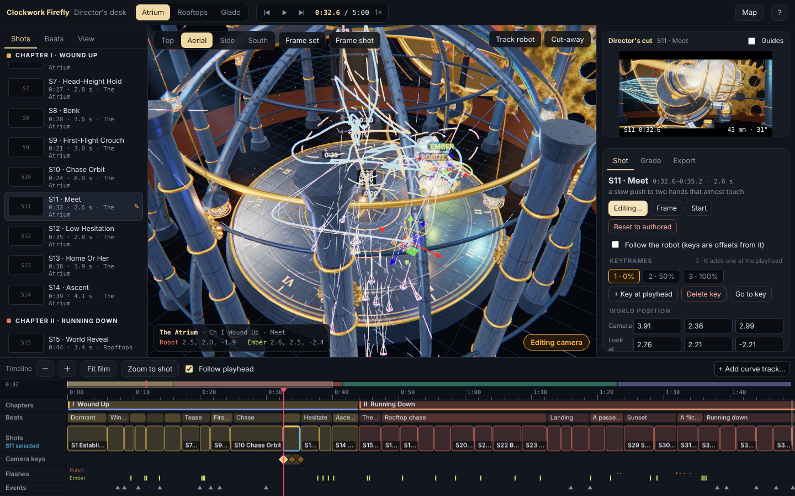

# Clockwork Firefly

Live: https://lagilava.github.io/Clockwork-Firefly-Three.js-Animation/ (film and Sculptor editor)



Open `Clockwork_Firefly_fullfilm.html` in a modern browser. The film remains a standalone HTML file; npm is only needed for the browser regression tests. Three.js and fonts load from their existing CDNs.

The player has an Original color grade and six optional director-inspired looks, including Zack Snyder. Choose a look from the Color grade menu beside the camera menu; the original chapter palettes remain active underneath each preset. The robot's back clockwork now fits its mounting plate, and Ember has a mottled shell, translucent veined wings, and small reflective eyes. Run `npm run test:characters` for a focused browser check of both models, every grade preset, and the portrait control layout. It saves close-view screenshots in `.validation/`.

The film is silent by design: all audio code has been removed, so there is no sound control. The lantern stalk clears the back gears throughout sampled poses. In the rooftop pursuit, Ember faces away from the robot and the robot flies an independent weaving line. Chapters III and IV use wider intimate shots with slow camera pans, arcs and changes in height. A ground-colored local bounce complements the existing sky and room irradiance in all three sets.

Animation now uses one integrated gear phase throughout the robot, with impact torsion shared by the meshed gears. Rooftop birds ease from a perch into flight, and the tower swifts bank while circling. The cat and owl react more smoothly to the robot, and the dawn butterflies have visible bodies and settle their wings when one lands on the robot's head. Ember's flight, landing, antennae and legs, along with the robot's steps and turning wingbeats, have also been refined. Ember's floor glow and the forest swarm lights now use the current animation frame, including after scrubbing.

The Director camera now gives the town, forest canopy, and sunrise valley more space around the characters. Select shots use a mid-distance low angle or a higher view to show where the action takes place. The homeward flight has an open path through both trunks and foliage, and moving camera setups use clear world-space routes through the forest and atrium. Selected action shots have gentle, deterministic handheld motion; quiet holds remain steady. Procedural masonry, stucco, town wall, rock, and canopy textures add surface variation to those wider views. For a focused visual camera check, run `CAMERA_REVIEW=1 npm run test:animation`; for the moving-camera collision scan, run `CAMERA_MOTION=1 npm run test:animation`, with `CAMERA_MOTION_FULL=1` to scan the full timeline (in PowerShell, set the environment variables first). Screenshots are saved in `.validation/`. The animation test serves its pinned Three.js dependency locally, so this validation does not depend on CDN availability.

The black screens had three causes:

- The forest ridgelines used lit materials without surface normals. Their shaders produced NaN colors, and bloom spread those invalid values across the whole image. The ridgelines now have normals, and bloom and grading also reject invalid HDR samples.
- The film explicitly faded to black around 1:53. Chapter changes now use a 0.85-second dissolve. Exploratory cameras show the scene through the opening and ending fades.
- The color grade subtracted dark lighting values around an inappropriate linear-light contrast pivot. The new grade preserves low-light detail, with less vignette and grain in the shadows.

Lighting now uses a matched HDR environment for every authored look, smoothly blended reflections, spherical-harmonic diffuse irradiance, and local bounce from practical lights. The sky, fog, moonlight, sunset and morning light follow the same look timeline in all four chapters. This is a real-time GI approximation suitable for interactive playback.

Performance changes include 57 batches of static dressing (181 fewer mesh draws), fewer shadow draws for tiny mechanical parts, half-resolution indoor ambient occlusion, smaller bloom targets, shader/texture/shadow preparation before playback, and automatic resolution scaling toward 60 fps. The animation loop remains uncapped for faster displays. Camera collision checks cover all four modes, and Free orbit follows the actor correctly when a set changes. Each chapter boundary and the return to the atrium dissolve from a saved frame, so a transition renders one live scene. Resolution changes are deferred during the dissolve.

Validation on 7 October 2026 used Chromium with an AMD Radeon integrated GPU through ANGLE/D3D11, at a 1280 × 720 viewport. Five separate playback samples measured approximately 59.94 fps, with 95th-percentile frame times of 16.9–17.0 ms and adaptive render scales of 0.78–0.86. These are measured results on this machine, not a guarantee for every GPU or display.

| Playback sample starts at | Original fps | Updated fps | Updated draw calls |
| --- | ---: | ---: | ---: |
| Atrium, 0:12 | 31.6 | 59.94 | 518 |
| Rooftops, 0:56 | 23.2 | 59.94 | 317 |
| Glade, 2:08 | 59.9 | 59.94 | 297 |
| Morning, 4:00 | 59.9 | 59.94 | 213 |
| Return home, 4:32 | 55.0 | 59.95 | 376 |

The baseline and updated runs both use automatic scaling; this table compares playback behavior rather than equal-resolution GPU benchmarks. Initial loading prepares rendering resources before the start screen; the tested first load took about 49 seconds including CDN loading and preparation.

The browser regression suite passed 112 sampled frames across Director, Follow, Face and Free orbit, all 16 chapter/set transitions, floor/canopy collision checks, desktop resizing and portrait rendering. The formerly failing 2:20 shot now has zero invalid HDR values. There were no browser or WebGL errors. Tests write their detailed results and screenshots to `.validation/`.

To repeat the tests with Node.js 20 or newer:

```powershell
npm ci
npx playwright install chromium
npm test
npm run test:animation
```

Optional environment variables `BROWSER_EXECUTABLE` and `PLAYWRIGHT_MODULE` select an existing Chromium executable and Playwright installation. FPS measurements use a fresh rendering session after correctness tests, since pixel readbacks deliberately stall the GPU. The notes panel (`N`) displays live fps, total draw calls and render scale.

The implementation follows the pinned Three.js r180 APIs for [GTAO shader parameters](https://github.com/mrdoob/three.js/blob/r180/examples/jsm/postprocessing/GTAOPass.js) and [HDR environment generation](https://github.com/mrdoob/three.js/blob/r180/src/extras/PMREMGenerator.js).

## Story and animation pass

Chapter titles now carry the theme: I Wound Up, II Running Down, III Borrowed Light, IV The Answer. Chapter cards no longer cover the film's biggest moments: II waits until the rooftop reveal has played, and III appears after the crash has landed.

Story changes:

- Two glints down the oculus shaft now cause the first wind-up, so light is established as what winds the robot from the opening.
- The robot's first failed attempt to flash like Ember is planted at the passenger beat (about 83 s), before the fizzle at 92 s.
- Ember's glow fades as morning comes (243 to 251 s), which gives her a reason to stay behind. The robot sends one small goodnight flash up the shaft before it rests, and the final answer now clicks the key one tooth, paying off the borrowed-light rule.
- Ember punctuates the wide rooftop shots with flashes so her performance reads at distance.

Animation changes:

- Wingbeats now have rhythm. The first flight stutters and glides, the rooftop chase tucks into glides on its dives, and the flight home uses long glides to read as mastery. Peak wingbeat rates are lower, so the robot no longer flaps like a hummingbird.
- Takeoff wing unfurls and the head-tilt double-takes use overshoot easing (`outBack`) instead of plain eases.
- The chase has more authored lag moments (about 27 s, 53 s and 66 s), so Ember and the robot move as two different weights.
- Camera push and arc drift was removed from 19 shots, mostly the held and quiet ones, so the remaining pushes mean something.
- The cut at 114 s is now a hard cut on the tumble, so the crash lands as authored. The other chapter changes still dissolve.

## Sculptor (the film editor)

`Clockwork_Firefly_godview.html` is an editing app for the film, with the whole set seen from above. Open it next to the film file (it loads the same three.js from the CDN). It starts paused at 0:12 and lays out like an NLE:

- **Viewport (centre)**: the set from Top / Aerial / Side / South (keys 1 to 4) or free orbit, with the robot path coloured by time, Ember's dashed path, time ticks, beat and shot labels, every authored camera with its view cone, and live markers. Track the robot, cut away the upper set, fog off, exposure. Hover a path for its time, click to jump.
- **Director's cut monitor (top right)**: the authored camera rendered through the film's full grade chain, live as you scrub, with rule-of-thirds and safe-area guides, timecode and lens readout.
- **Shots / Beats / View (left)**: all 96 shots with thumbnails (Capture all shots), grouped by chapter. Click to seek, `E` to edit.
- **Inspector (right)**: *Shot* edits the selected shot's camera keyframes (position and target gizmos in the viewport, FOV, roll, shake, follow-robot mode, numeric fields, add keyframe with `K`, delete with `Delete`). *Grade* is a full colour grade (shadows / mids / highlights tint, saturation, contrast, warmth, grain, lift, vignette, exposure, bloom) with presets. *Export* downloads or imports the edits.
- **Timeline (bottom)**: chapters, shots, beats, events and keyframes on one scrubbable, zoomable track, plus any film curve (add from the menu). Drag the grip to resize it.
- `?` lists every shortcut, `M` opens a map of all three sets at once.

### Custom projects

The start page (`index.html`) has three buttons: **Custom projects**, **Default film** and **Sculptor** (the editor).

- Your work in Sculptor autosaves as a draft in this browser. Press **Save project** (or Ctrl+S) to keep it as a named project. The project menu in the top bar switches, renames, copies and deletes projects, and imports or downloads a project file.
- `projects.html` lists the saved projects. **Play in film** opens `Clockwork_Firefly_fullfilm.html?project=<id>`, which plays the film with that project's cameras and colour grade (a small chip at the bottom left says which project is playing and links back to the original). **Edit in Sculptor** opens `Clockwork_Firefly_godview.html?open=<id>`.
- Projects live in the browser's local storage (`clockwork.projects.v1`), so they are per browser and per device. Download a file to back one up or move it.

### Making a project permanent

To bake the cameras and grade into the film itself for everyone, export a file (project menu, Download file) and run:

```
node tools/apply-overrides.cjs clockwork-edits.json   # bakes shot cameras and the colour grade into the film
npm run build:godview                                  # regenerates the editor from the film
```

An overridden shot drops its automatic camera drift and follows your keyframes; the grade appears in the film's grade menu as "Director's grade" and is selected by default.

The editor is generated, never edited by hand: `npm run build:godview` reads `Clockwork_Firefly_fullfilm.html` and injects `tools/godview.inject.js` (with `godview.studio.js` spliced in), `godview.timeline.js`, `godview.ui.html` and `godview.css` into a copy. `npm run test:godview` boots it in headless Chromium and saves screenshots (set `GV_FILE`, `THREE_ROOT`, `PLAYWRIGHT_MODULE`, `GV_STEPS`, `GV_VIEWPORT` for custom runs). `npm run test:projects` checks the whole save, list and play-in-film flow.

## World viewing rig and town plan

`npm run view:world -- <outDir> [tag]` renders every set from a map (top-down), aerial and ground camera and saves PNGs. It serves the pinned Three.js locally, so it needs no CDN. Set `VIEWS` to a JSON list of `[set, time, name, cameraPos, target, fov, options]` entries to render your own views, and `BROWSER_EXECUTABLE` to use an existing Chromium.

The rooftop town now has a plan instead of a uniform grid of houses:

- An east avenue runs from the terrace to the woods (the road Ember takes) and a cross street frames the clock tower.
- A fountain plaza sits on the cross street, ringed with lamps.
- A copper-domed observatory gives the skyline a second landmark.
- Street lamps along both avenues switch on with the town's dusk lights.
- The old town rises slightly toward the terrace.

## Forest, last chapter

- Tree trunks were 30 units tall and ended in flat black caps that poked through the canopy, which showed in the top-down descent (about 258 to 261 s). Trunks now taper to a thin tip, are shorter, and every trunk wears a crown. The crowns use their own random stream, so the authored forest layout is unchanged.
- The distant home town was a pink box and spire hanging in the fog. It now has a belfry, a dial ring, lit windows, gable-roofed houses and its own ground plain, and its windows and roofs warm with the dawn.
- `tools/directorframes.cjs` renders the director's-cut frame at any film times (`TIMES=244,257 node tools/directorframes.cjs <outDir>`).

## Smoothness checks

- **Shader pre-compilation.** The film used to compile a few dozen shader programs while playing (15 at the hard cut near 1:54, others near 0:20, 0:44 and 1:16), and every compile is a visible hitch on a real GPU. The loader now renders extra warm-up frames at those moments and rolls through the 0:44 dissolve, so nothing compiles during playback. `PLAY=1 node tools/proghunt.cjs Clockwork_Firefly_fullfilm.html 0 0 299` plays the whole film and lists any program that still appears (the target is zero).
- **Paused frames.** When the film is paused and nothing has changed, the frame is not re-rendered (it refreshes about four times a second). Seeking, dragging, grading and playing redraw at once. `node tools/perfidle.cjs` checks this.
- **Sculptor.** It also skips redundant redraws while you are not touching anything, and the preview monitor is on `Auto`: full rate, dropping to every 2nd or 4th frame only when the editor falls below about 50 fps and recovering when it is fast again. Pick a fixed rate in the monitor menu to override.
- `node tools/perfprobe.cjs` prints per-stage CPU time, draw calls and program counts at sample moments. The headless browser uses software GL, so only those counts, not frame rates, are comparable.

## Grading and motion controls

The Sculptor's Grade tab has 25 sliders in four groups, plus three tint pickers, all baked into the film on export:

- **Light:** exposure, bloom, gamma, contrast and its pivot, shadows, highlights, black lift, matte fade.
- **Colour:** saturation, vibrance, warm highlights, temperature, tint, hue shift.
- **Texture:** grain and grain size, sharpen, halation, light streaks, colour fringe.
- **Frame:** vignette strength, softness and depth, letterbox bars.

Switch the scope at the top of the tab from **Whole film** to **S# only** to grade a single shot. A shot's own values replace the film grade for that shot only, rows that differ are highlighted, and each has an undo arrow. Shots with their own grade show a ◐ in the shot list. In the export, a grade is a plain object of these values with an optional `shots` map keyed by the shot's start time, so older exports still load and neutral values change nothing (checked pixel for pixel against the previous film).

Edited camera shots also get a **Motion** setting: smooth (default), linear, ease in, ease out or slow-fast-slow. With three or more keys, anything other than smooth runs straight segments between keys with that easing.

`npm run test:grade` checks the sliders, per-shot scope, undo and reset, the Motion setting, and that a saved project plays its shot grade in the film.

## Sculptor editor tools

- **LUTs.** Import a `.cube` file (3D, or 1D which is converted) with the button under Colour LUT in the Grade tab, or drop it anywhere on the desk. Its strength is a slider and can differ per shot. The LUT runs after tone mapping on the final image, is stored inside the grade (resampled to at most 33 points) and is baked into the film on export. The film adds the pass only when a LUT is present.
- **Undo and redo** (Ctrl+Z, Ctrl+Shift+Z or the top bar buttons) cover cameras, grade and notes, 60 steps.
- **Copy and paste** a shot's camera (Ctrl+C, Ctrl+V) or its grade (Ctrl+Shift+C, Ctrl+Shift+V, or "Paste to chapter").
- **My looks:** save the current grade by name; it is available in every project in this browser.
- **Notes** per shot, shown in the shot list with a marker, and a find box (`/`) with Camera, Graded and Notes filters.
- **Save still** writes the monitor frame as a PNG.
- **Layout:** drag the edges of the shot list, the inspector and the monitor (double-click an edge to reset), or fold the monitor away. The layout is remembered.
- **Map.** Open it with `M`. Pick a set to see it large with a metre grid; the wheel zooms, dragging the background pans, double-click resets the view. In Cameras mode the camera keys of edited shots are squares and their aim points diamonds: drag them directly, or click a blue dot to pick that shot. "Edit camera" turns an authored shot into editable keys. The camera you are looking through is drawn with its aim line and lens cone.

## Studio tools: versions, loop, guides, quality and export

- **Versions.** The Versions tab saves named snapshots of the whole cut (cameras, grade, notes). Pick two as A and B and press `\` to flip between them; the desk re-samples only the shots that differ, lists what changed, and keeps any unsaved work as an automatic version before it switches, so a flip never loses anything. Versions are stored in this browser.
- **Loop and shuttle.** `J` plays backwards, `K` pauses, `L` plays forward (press again for 2× and 4×). `R` loops the selected shot, or the In to Out range if one is set (`I`, `O`, `X` to set and clear; the range is a blue band on the timeline). While a camera is being edited, `K` still adds a keyframe.
- **Frame guides.** The Guides menu on the monitor crops to 16:9, 2.39:1, 4:5, 1:1 or 9:16 and can show thirds, action and title safe areas and a centre mark.
- **Preview quality.** Auto, Full, Balanced or Light (bottom right of the viewport). Balanced and Light render the viewport at 75% or 50% resolution and the monitor every 2nd or 4th frame. Exports always render at full quality.
- **Export.** The Export button renders a range (selected shot, In to Out, or the whole film) frame by frame, so the result is exact even on a slow machine. Choose a video clip (`.webm`, VP8 via WebCodecs) or a still sequence (`.zip` of PNG or JPEG), 640×360, 1280×720 or 1920×1080, 12 to 60 fps, and any guide shape to crop to. The film is stepped by whole frames through `st.fixedDt`, which is unset during normal playback.

`npm run test:desk`, `npm run test:map` and `npm run test:studio` check the editor tools (they are slow under software GL; the studio test also checks the zip and the webm with `ffprobe`).
